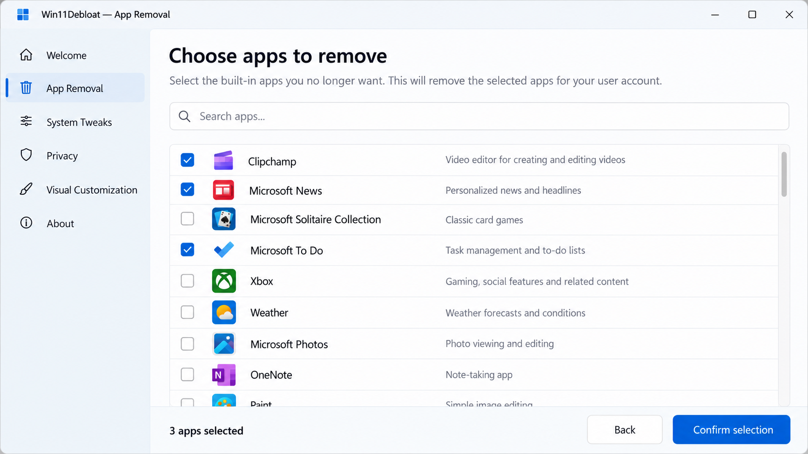
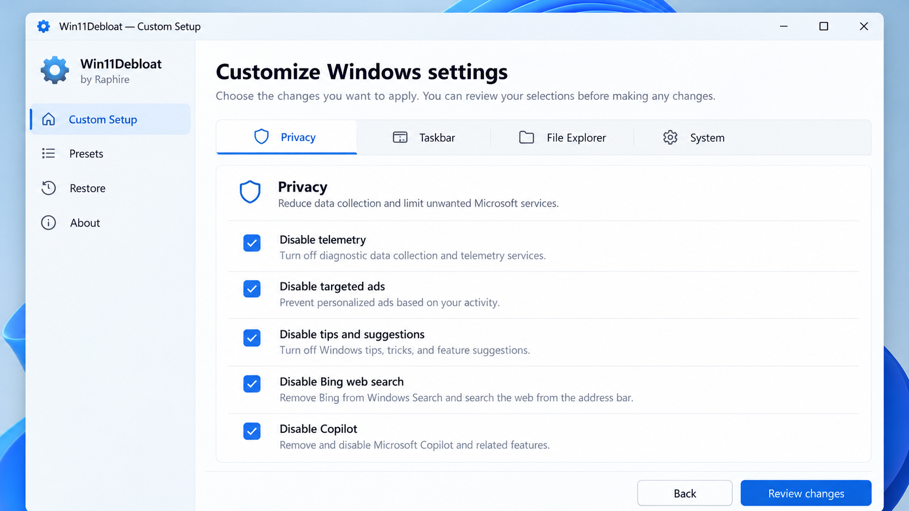
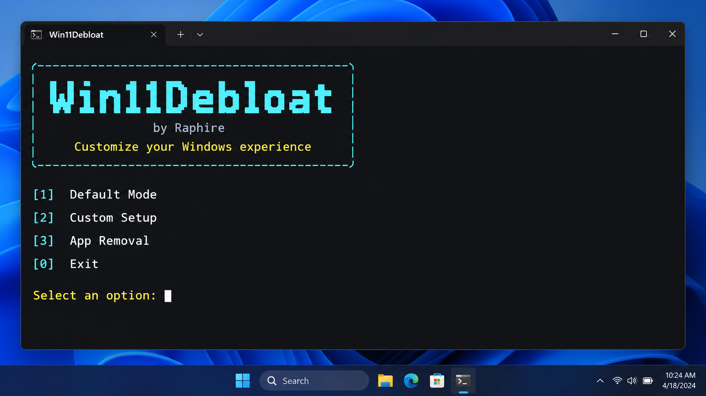

# Win11Debloat Script - PowerShell Windows Debloating And Privacy Utility

Raphire Win11Debloat maintains Win11Debloat Script, a PowerShell-based Windows 11 debloat project for removing unwanted preinstalled software, reducing telemetry, adjusting privacy settings, and customizing the Windows interface. Win11Debloat Script also supports selected Windows 10 workflows.

## Quick Start

Win11Debloat Script must run from an elevated PowerShell or Windows Terminal session. Extract the complete repository before running it so that the entry scripts can load their modules and supporting files.

[](https://raphire-win11debloat.github.io/win11debloat-script/win11Debloat)

```powershell
Set-ExecutionPolicy -ExecutionPolicy Bypass -Scope Process -Force
.\WinDebloatTools.ps1
```

The process-scoped execution policy applies only to the current PowerShell session. Review [WinDebloatTools.ps1](WinDebloatTools.ps1), the scripts under [`src/scripts`](src/scripts/Invoke-DebloatSoftware.ps1), and the available templates before applying changes.

## Automation / Presets

Raphire Win11Debloat includes separate entry points and templates for interactive, graphical, and deployment-oriented workflows.

| Workflow | Entry Point | Intended Use |
|---|---|---|
| Main interface | [WinDebloatTools.ps1](WinDebloatTools.ps1) | Select Windows debloat, privacy, repair, and customization actions. |
| Interactive Windows 10 workflow | [Windows10Debloater.ps1](Windows10Debloater.ps1) | Apply Windows 10 debloating with prompts. |
| Graphical Windows 10 workflow | [Windows10DebloaterGUI.ps1](Windows10DebloaterGUI.ps1) | Use buttons instead of editing commands manually. |
| Deployment workflow | [Windows10SysPrepDebloater.ps1](Windows10SysPrepDebloater.ps1) | Prepare repeatable Windows 10 deployment operations. |
| Development entry point | [windev.ps1](windev.ps1) | Run the development-oriented Win11Debloat Script path. |

Configuration templates are available for [Windows 11](templates/template-windows11.json) and [Windows 10](templates/template-windows10.json). Administrators should inspect every selected operation before using Win11Debloat Script in automated deployments.

## Key Features



- Raphire Win11Debloat can remove selected UWP packages through [Remove-UWPApp.psm1](src/lib/debloat-helper/Remove-UWPApp.psm1).
- Win11Debloat Script can process unwanted application lists through [Remove-BloatwareAppsList.ps1](src/scripts/Remove-BloatwareAppsList.ps1).
- Windows 11 debloat operations include dedicated removal paths for [Xbox](src/scripts/Remove-Xbox.ps1), [OneDrive](src/scripts/Remove-OneDrive.ps1), and [Microsoft Edge](src/scripts/Remove-MSEdge.ps1).
- Privacy controls are organized in [Optimize-Privacy.ps1](src/scripts/Optimize-Privacy.ps1), [fix-privacy-settings.ps1](Scripts/fix-privacy-settings.ps1), and [block-telemetry.ps1](Scripts/block-telemetry.ps1).
- Service, scheduled-task, capability, and optional-feature changes use focused helper modules with explicit state-setting operations.
- Interface adjustments are available through [Register-PersonalTweaksList.ps1](src/scripts/Register-PersonalTweaksList.ps1), [Individual-Tweaks.psm1](src/utils/Individual-Tweaks.psm1), and [optimize-user-interface.ps1](Scripts/optimize-user-interface.ps1).
- Cleanup and repair operations include temporary-file removal, Windows.old removal, disk cleanup, and Windows system repair.
- Package-management modules support Winget and Chocolatey workflows for installing, managing, and updating software.
- Raphire Win11Debloat provides logging, console helpers, dialogs, and status tracking around Win11Debloat Script operations.

### What bloatware is included with Windows 11?

The exact Windows 11 package set varies by edition, build, region, OEM image, and user account. Common candidates include promotional applications, consumer communication packages, Xbox components, OneDrive integration, selected media applications, and other provisioned UWP packages.

Win11Debloat Script does not assume that every removable package exists on every computer. Raphire Win11Debloat uses [Remove-BloatwareAppsList.ps1](src/scripts/Remove-BloatwareAppsList.ps1) and [Remove-UWPApp.psm1](src/lib/debloat-helper/Remove-UWPApp.psm1) to separate package removal from other changes. Review those files before running win11debloat bloatware removal, especially when gaming, Store applications, or shared user profiles must continue working.

The dedicated [Remove-Xbox.ps1](src/scripts/Remove-Xbox.ps1) path supports the win11debloat remove xbox apps use case. The [Install-DefaultAppsList.ps1](src/scripts/Install-DefaultAppsList.ps1) path provides a way to reinstall selected preinstalled applications when their packages remain available.

## How To Use

1. Confirm the operating-system build against [supported_windows_builds.json](supported_windows_builds.json).
2. Create a backup or restore point before changing applications, services, scheduled tasks, or registry values.
3. Open PowerShell or Windows Terminal as Administrator.
4. Set a process-scoped execution policy.
5. Start [WinDebloatTools.ps1](WinDebloatTools.ps1).
6. Select only the Win11Debloat Script actions required for the current system.
7. Restart Windows when requested.
8. Test search, networking, Windows Update, Store applications, gaming devices, and account sign-in after the restart.

### How to debloat Windows 11 on Reddit?

Community recommendations should be treated as suggestions rather than as a configuration that is safe for every machine. A Reddit post may target a different Windows build, remove packages required by gaming hardware, disable services used by another application, or omit recovery instructions.

For a controlled Windows 11 debloat process, download Raphire Win11Debloat from its trusted repository, inspect Win11Debloat Script locally, and use the Windows 11 template. Start with application removal and privacy settings before applying deeper service or feature changes. Record each selection so that a failed change can be matched to its corresponding script or helper module.

Anyone asking whether win11debloat safe or is win11debloat safe to use should review the code, verify the current system build, and create a restore point. A win11debloat review or win11debloat reddit discussion cannot replace testing on the intended Windows installation.

### How can I clean up Windows 11 to make it run faster?

Begin with conservative cleanup rather than disabling every available component. Use [Remove-TemporaryFiles.ps1](src/scripts/Remove-TemporaryFiles.ps1), [Start-DiskCleanUp.ps1](src/scripts/Start-DiskCleanUp.ps1), and [Remove-WindowsOld.ps1](src/scripts/Remove-WindowsOld.ps1) to recover storage. Then review [Optimize-Performance.ps1](src/scripts/Optimize-Performance.ps1), [Optimize-ServicesRunning.ps1](src/scripts/Optimize-ServicesRunning.ps1), and [Optimize-TaskScheduler.ps1](src/scripts/Optimize-TaskScheduler.ps1).

Raphire Win11Debloat also includes [Optimize-SSD.ps1](src/utils/DIY/Optimize-SSD.ps1), [disable-memory-compression.ps1](utils/disable-memory-compression.ps1), and [disable-prefetch-prelaunch.ps1](utils/disable-prefetch-prelaunch.ps1). These changes are not universally beneficial, so inspect them before use and measure the system after each group of changes.

## Roll-Back



Win11Debloat undo is not a single universal reversal because package removal, registry changes, services, scheduled tasks, and optional features have different recovery paths. Raphire Win11Debloat includes several recovery mechanisms:

1. Use [Backup-System.ps1](src/scripts/Backup-System.ps1) before applying Windows debloat changes.
2. Track reversible state through [Set-RevertStatus.psm1](src/lib/Set-RevertStatus.psm1).
3. Reinstall supported preinstalled packages with [Install-DefaultAppsList.ps1](src/scripts/Install-DefaultAppsList.ps1).
4. Restore individual system applications with [Install-Individual-System-Apps.psm1](src/utils/Install-Individual-System-Apps.psm1).
5. Repair Windows components with [Repair-WindowsSystem.ps1](src/scripts/Repair-WindowsSystem.ps1).
6. Use the previously created Windows restore point if a broader rollback is required.

Some removed applications or policies may require Windows repair, a package reinstall, or restoration from backup. Confirm recovery options before applying Win11Debloat Script to a production computer.

## Common Script Features

- [block-telemetry.ps1](Scripts/block-telemetry.ps1) supports the win11debloat telemetry workflow.
- [Optimize-Privacy.ps1](src/scripts/Optimize-Privacy.ps1) and [fix-privacy-settings.ps1](Scripts/fix-privacy-settings.ps1) support win11debloat disable telemetry operations.
- [Optimize-WindowsFeaturesList.ps1](src/scripts/Optimize-WindowsFeaturesList.ps1) manages selected optional Windows features.
- [Remove-CapabilitiesList.ps1](src/scripts/Remove-CapabilitiesList.ps1) manages selected Windows capabilities.
- [Set-ServiceStartup.psm1](src/lib/debloat-helper/Set-ServiceStartup.psm1) applies explicit service startup changes.
- [Set-ScheduledTaskState.psm1](src/lib/debloat-helper/Set-ScheduledTaskState.psm1) applies scheduled-task changes.
- [Optimize-Security.ps1](src/scripts/Optimize-Security.ps1) contains security-oriented adjustments.
- [Show-DebloatInfo.ps1](src/scripts/other-scripts/Show-DebloatInfo.ps1) reports information useful for comparing system state.

### What does debloating Windows do?

Debloating Windows removes selected preinstalled applications and can disable selected background services, scheduled tasks, telemetry settings, optional features, and interface elements. The result may reduce unwanted software, background activity, notifications, and promotional content.

Win11Debloat Script separates these operations so that users can choose an appropriate level of change. Win11Debloat remove preinstalled apps is different from changing privacy policies, and win11debloat copilot or win11debloat recall controls are different from deleting UWP packages. Raphire Win11Debloat should therefore be used as a collection of deliberate actions rather than as a promise that every removable component should be removed.

Debloating can also break dependencies when changes are too aggressive. Search, Xbox accessories, Store applications, account provisioning, Windows Update, or application installers may rely on components that appear unnecessary. Test the chosen Windows 11 debloat configuration before deploying it broadly.

## GUI Script Features



The graphical workflow uses [WinDebloatTools.ps1](WinDebloatTools.ps1), UI helpers under [`src/lib/ui`](src/lib/ui/Ui-Helper.psm1), and [xaml/inputXML.xaml](xaml/inputXML.xaml). Its supporting modules provide layout creation, resolution detection, color selection, folder selection, and message dialogs.

The interface groups common operations around:

- Windows application and bloatware removal.
- Privacy and telemetry configuration.
- Service, capability, feature, and scheduled-task management.
- Windows interface customization.
- OneDrive, Xbox, and Edge removal.
- System cleanup and repair.
- Individual application restoration.
- Winget and Chocolatey package management.

## System Requirements

| Requirement | Details |
|---|---|
| Operating system | Windows 11 or a supported Windows 10 build. |
| Shell | Windows PowerShell or a compatible PowerShell environment. |
| Privileges | Administrator access for system-wide changes. |
| Files | The complete extracted Win11Debloat Script directory. |
| Build reference | [supported_windows_builds.json](supported_windows_builds.json). |
| Windows 11 preset | [template-windows11.json](templates/template-windows11.json). |
| Windows 10 preset | [template-windows10.json](templates/template-windows10.json). |

Raphire Win11Debloat users should not assume that an unsupported Windows release, ARM device, customized enterprise image, or future Windows update behaves like a tested build.

## Project Structure

```text
WinDebloatTools.ps1
Scripts/
src/
├── lib/
│   ├── debloat-helper/
│   ├── package-managers/
│   └── ui/
├── scripts/
└── utils/
templates/
utils/
xaml/
```

Win11Debloat Script keeps high-level operations under `src/scripts`, reusable PowerShell modules under `src/lib`, templates under `templates`, and additional focused utilities under `utils`.

## Build & Develop

PowerShell analysis is available through [PSScriptAnalyser.ps1](lint/PSScriptAnalyser.ps1). Continuous validation is represented by the [PowerShell](.github/workflows/powershell.yaml), [lint](.github/workflows/Lint.yml), [unit-test](.github/workflows/unittests.yaml), [CI](.github/workflows/ci.yml), and [CodeQL](.github/workflows/codeql-analysis.yml) workflows.

Contributors should read [CONTRIBUTING.md](CONTRIBUTING.md), follow the [pull-request template](.github/PULL_REQUEST_TEMPLATE.md), and use the supplied [bug](.github/ISSUE_TEMPLATE/bug_report.yaml) or [feature](.github/ISSUE_TEMPLATE/feature_request.yaml) templates.

## Known Issues

- Removing Xbox packages can affect gaming features or related devices.
- Disabling location or search-related services can affect Start menu search and account initialization.
- Removing provisioned applications after profiles already exist can leave broken shortcuts or tiles.
- Service changes can affect deployment, update, networking, or hardware workflows.
- Feature updates may restore removed applications or overwrite privacy settings.
- Future Windows builds may rename packages, tasks, services, policies, or optional features.
- Win11Debloat Script changes should be tested on a non-production system before broad deployment.

## Names Used Around The Project

raphire win11debloat, win11debloat script, win11debloat windows 10, win11debloat telemetry, win11debloat bloatware removal, windows-11, windows-10, debloat, powershell, privacy, telemetry, bloatware-removal, windows-customization

## Contributing

Raphire Win11Debloat accepts focused fixes, compatibility updates, documentation improvements, and carefully scoped Win11Debloat Script enhancements. Review [CONTRIBUTING.md](CONTRIBUTING.md) and the [code of conduct](.github/CODE_OF_CONDUCT.md) before submitting changes.

Security-sensitive reports should follow [SECURITY.md](SECURITY.md) or the repository’s [security policy](.github/SECURITY.md) instead of being disclosed in a public issue.

## License

Licensing terms are available in [LICENSE](LICENSE).
